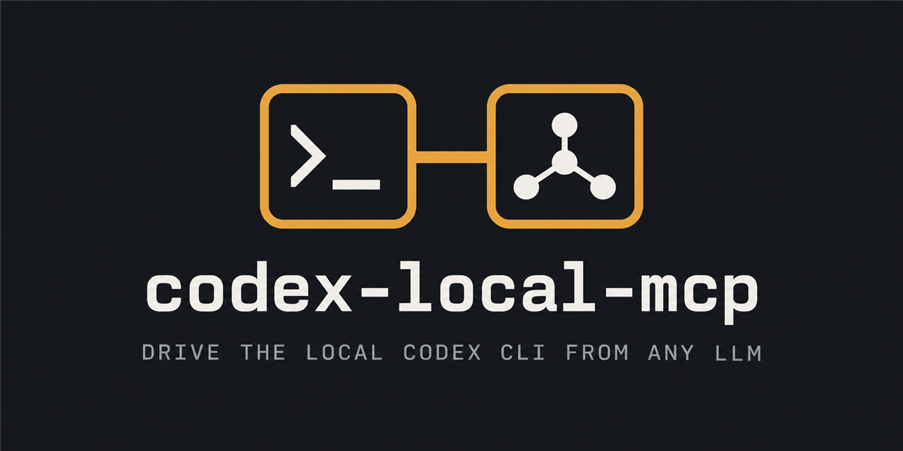

<p align="center">
  
</p>

<p align="center">
  <a href="https://github.com/ossmalaysia/codex-local-mcp/actions/workflows/ci.yml"></a>
  <a href="LICENSE"></a>
</p>

# codex-local-mcp

An MCP server that lets any LLM drive your **local Codex CLI**.

The calling model sends a task in plain English. Codex writes and runs code inside an
isolated workspace folder on your machine. The server returns Codex's output, the list of
files it created, and the images inline.

Codex generates images natively, so `codex_generate_image` needs no image API key — your
existing `codex login` is enough.

> **This runs code on your computer.** Anything that can call these tools can make Codex
> execute code as you, inside its sandbox. Read [SECURITY.md](SECURITY.md) before using it.

## Requirements

- Node.js 20 or newer
- [Codex CLI](https://github.com/openai/codex) installed and logged in
- Windows, macOS or Linux

## Windows installer

Download **CodexLocalMCP-VERSION-windows-x64-setup.exe** from [Releases](https://github.com/ossmalaysia/codex-local-mcp/releases).
Open it, select **Install**, then select **Finish**. Setup extracts the files and creates a Start menu shortcut.
It installs for your Windows account and adds an entry under **Settings → Apps → Installed apps**.
The setup executable uses its own verified extraction process, which avoids the stalled MSI validation stage.
Existing login settings and workspaces remain separate from the application files.
Close any running copy from its tray menu before installation.

The app stays in the system tray when its window closes. Select **Exit** from the tray menu to stop it.
It checks the latest stable GitHub release after startup and every 12 hours. A tray notice appears when an update is available.
Select the notice or **Check for updates** to review and download the update. Installation requires a second confirmation.
Updates stage the new application, keep the previous directory, replace the application folder, and restart the app.
The application validates GitHub's SHA256 digest, exact repository and asset name, download size, redirect hosts, and package metadata.
ZIP updates also reject unsafe paths, links, duplicate names, and excessive extracted sizes.
MCP credentials are not passed to the updater or installer. Downloads stay in the private application data folder.
GitHub HTTPS and the repository account are the update trust source. Releases currently have no independent publisher signature.

The new setup uses a separate application folder when an old MSI installation exists.
The old MSI registration stays intact. This avoids overwriting files managed by Windows Installer.
Internal update ZIP files are downloaded and extracted by the app. Users do not need to copy or extract them.

The update flow follows the same stages as [EzyChat Lite](https://github.com/ossmalaysia/ezychat-lite/tree/main/apps/desktop/src/updater): check, notify, download, verify, confirm, replace, restart.

### Runtime and Rust options

The Windows manager uses C# and the installed .NET Framework. The MCP server uses TypeScript and a bundled Node.js runtime.
The desktop build bundles server dependencies to reduce installation file operations. Native image processing remains a separate dependency.
The measured app file count fell from 3,821 to 161 before the added HTTP verification bundle.
The manager executable used about 64 KB before the updater. The pinned Node runtime uses about 90 MB; the pinned Codex executables use about 430 MB.
Changing the manager language cannot remove those separate runtime files or fix Windows Installer validation.

A native Rust MCP server could use the [official Rust SDK](https://github.com/modelcontextprotocol/rust-sdk) and remove the separate Node.js runtime.
That migration must preserve OAuth login, PKCE, refresh-token reuse protection, MCP Apps, image handling, job control, and Windows sandbox checks.
The current change keeps the tested TypeScript server. The setup and update process avoids Windows Installer.

Download the versioned Windows x64 setup executable and its SHA256 file from [Releases](https://github.com/ossmalaysia/codex-local-mcp/releases).
The installer includes Node.js, Codex CLI, Cloudflare Tunnel, and a Windows configuration app.
It installs for the current Windows user and registers a Start menu shortcut.

Open **Codex Local MCP** from the Start menu. Then:

1. In **Workspace**, select **Choose folder** and choose a dedicated local workspace. Select **Continue**.
2. In **Accounts**, enter your MCP username. Enter or generate a password, then copy it to your password manager.
3. Select **Sign in to Codex** and complete the OpenAI login. Select **Continue**.
4. In **Connection**, keep **Quick Tunnel** for the first setup. No Cloudflare account is required.
5. Select **Start connection**. The app saves settings and checks sandbox isolation before startup.
6. In **Use in Claude**, select **Copy URL**. Add that URL as a custom connector in Claude.
7. Connect the connector and enter the MCP username and password you configured.

The app shows connection status in the sidebar. **View activity** opens diagnostic output.
**Advanced settings** contains the Windows sandbox backend, command networking, and local listener port.
Named tunnel fields appear only when **Named Tunnel** is selected.
A Quick Tunnel URL changes after restart. Update the connector in Claude with the new URL.
Keep the app open and the PC awake while the remote connection is in use.

The default backend is MXC. It requires a compatible, updated Windows device.
The elevated legacy backend requires its own sandbox setup and can need administrator approval.
The application always uses the isolated permission profile. It never selects full access or the unelevated backend.
Read-only runtime paths remain available. Private application settings and Codex credentials have an explicit deny rule.
Command networking is disabled by default. Enable it only when your tasks need network access.
Codex model authentication still requires an Internet connection.

Before remote startup, a real sandbox check verifies workspace writes and denied private reads and writes.
When networking is disabled, it also verifies that a local test connection is denied.
If any check fails, remote startup stops. The check does not call an AI model.

For a permanent address, select **Named Tunnel**, then **Sign in to Cloudflare**.
Approve your domain in the browser. Select **Load domains** to use a saved sign-in.
Choose a domain and address name, then select **Create address**.
The app creates the tunnel, DNS record, and local route. It rejects conflicting DNS records.
Select **Start connection** after the address is ready.
For an existing tunnel, select **Use an existing tunnel** and enter its HTTPS origin and token.
For that manual option, configure the hostname route to `http://127.0.0.1:<your listener port>` in Cloudflare.
Cloudflare account credentials use Windows DPAPI encryption. They stay in the manager and do not reach Codex or the MCP server.
Passwords and tunnel tokens use Windows DPAPI encryption for the current user.
Settings and Codex login files are stored under `%LOCALAPPDATA%\CodexLocalMCPData`.
The workspace must be separate from that folder and the installation folder.
Updates and uninstall preserve settings and workspaces.

The setup version, configuration app version, MCP server version, and release manifest use the release tag.
The manifest records the source commit and bundled tool versions.
Release builds require a clean checkout of the exact tag.
The generated setup executable is unsigned unless a release operator applies an Authenticode signature.

See [official Windows sandbox documentation](https://learn.chatgpt.com/docs/windows/windows-sandbox)
and [Codex permission profiles](https://learn.chatgpt.com/docs/permissions).

## Install

New to this? Follow the **[step-by-step setup guide](SETUP.md)** instead, which covers
finding your paths, configuring each client, verifying it works, and troubleshooting.

```bash
npm install -g @openai/codex   # the Codex CLI itself
codex login                    # one time

git clone https://github.com/ossmalaysia/codex-local-mcp.git
cd codex-local-mcp
npm install
npm run build
```

## Connect it to a client

> Full walkthrough with per-OS paths and troubleshooting: **[SETUP.md](SETUP.md)**.

The default transport is **stdio**. The client launches the server as a child process.
For remote access through an HTTPS endpoint, use [Remote access with OAuth](#remote-access-with-oauth).

Use **absolute paths** for `command` and for `CODEX_BIN`. MCP clients launch servers with a
minimal environment in which bare `node` and `codex` may not resolve.

### Claude Desktop

Add to `claude_desktop_config.json`, then fully quit and reopen the app.

- Windows: `%APPDATA%\Claude\claude_desktop_config.json`
- macOS: `~/Library/Application Support/Claude/claude_desktop_config.json`

```json
{
  "mcpServers": {
    "codex": {
      "command": "/absolute/path/to/node",
      "args": ["/absolute/path/to/codex-local-mcp/dist/index.js"],
      "env": {
        "CODEX_BIN": "/absolute/path/to/codex",
        "CODEX_MCP_ROOT": "/absolute/path/to/codex-workspaces",
        "CODEX_TIMEOUT_SEC": "600"
      }
    }
  }
}
```

On Windows the values look like `C:/Program Files/nodejs/node.exe` and
`C:/Users/you/AppData/Roaming/npm/codex.cmd`. Forward slashes work fine.

Find the right paths with `which node` / `which codex` (macOS, Linux) or
`(Get-Command node).Source` / `(Get-Command codex).Source` (PowerShell).

### Claude Code

```bash
claude mcp add codex -s user -- node /absolute/path/to/codex-local-mcp/dist/index.js
```

### Anything else

Any MCP client that can launch a stdio server works. Point it at
`node /absolute/path/to/dist/index.js`.

## Remote access with OAuth

HTTP mode exposes `/mcp` through Streamable HTTP. It includes browser login, OAuth discovery,
dynamic client registration, and authorization codes with PKCE S256.

This mode serves one trusted owner. All authorized clients share the local Codex account,
jobs, artifacts, and workspace root. It does not provide separate accounts or workspace isolation between clients.

First, run `codex login` on the server machine. Use the same operating system account that starts this server.
The server checks `codex login status` at startup and before MCP requests, with a 30-second success cache.
This checks local login status. It does not verify subscription limits or make a live OpenAI request.

### Built-in Cloudflare Tunnel

Install `cloudflared` first. Then run:

```bash
npm run build
npm run start:tunnel
```

The command requests an administrator username and password if `CODEX_MCP_PASSWORD` is not set.
Password input is hidden. These credentials stay in memory for the current server session.
Use at least 24 characters for the password.
Codex keeps its existing local login. You do not enter your OpenAI password into the MCP login page.

The server starts a Cloudflare Quick Tunnel and prints its public `/mcp` URL.
It also prints the exact `claude mcp add` command.
OAuth discovery and callbacks use the generated public address automatically.
No Cloudflare account or domain is required.

Keep the terminal open while you use remote MCP. Press Ctrl+C to stop the server and tunnel.
If the connector stops unexpectedly, the server closes its listener.
The next start creates a new public hostname and requires a new client login.

Quick Tunnels are for testing and development. They do not support SSE.
This server uses JSON responses with Streamable HTTP.
For a stable hostname, configure a named tunnel separately and use the manual setup below.
See [Cloudflare Quick Tunnels](https://developers.cloudflare.com/tunnel/get-started/quick-tunnels/).

For unattended startup, set `CODEX_MCP_USERNAME` and `CODEX_MCP_PASSWORD` before running the command.
Alternatively, set `CODEX_MCP_TUNNEL=quick` and run `npm start` with those credentials configured.
If executable discovery fails, set `CLOUDFLARED_BIN` to the absolute `cloudflared` executable path.
The built-in tunnel requires a loopback listener. It uses a temporary empty connector configuration.
It does not modify your existing Cloudflare configuration or forward application credentials to the connector.

### Manual HTTPS setup

Set these variables in PowerShell:

```powershell
$env:CODEX_MCP_TRANSPORT = "http"
$env:CODEX_MCP_PUBLIC_URL = "https://codex.example.com"
$env:CODEX_MCP_USERNAME = "admin"
$env:CODEX_MCP_PASSWORD = [System.Net.NetworkCredential]::new("", (Read-Host "MCP password (at least 24 characters)" -AsSecureString)).Password
$env:CODEX_MCP_ROOT = "D:/codex-workspaces"
# Set CODEX_BIN to your absolute Codex CLI path if required.
npm run build
npm start
```

Use a unique password with at least 24 characters. Passwords cannot exceed 1024 UTF-8 bytes.
On macOS or Linux, set the same environment variables before running `npm start`.

The listener defaults to `127.0.0.1:3000`. Put an HTTPS reverse proxy or tunnel in front of this listener.
Forward the entire public origin, including `/authorize`, `/login`, `/register`, `/token`, `/revoke`, and `/.well-known/*`.
Use an HTTPS origin without a path for `CODEX_MCP_PUBLIC_URL`.
Manual mode uses your existing HTTPS proxy or tunnel.

For example, Caddy can terminate HTTPS for your configured domain:

```caddyfile
codex.example.com {
    reverse_proxy 127.0.0.1:3000
}
```

Connect Claude Code to the public endpoint:

```bash
claude mcp add --transport http codex-remote https://codex.example.com/mcp
```

Run `/mcp` in Claude Code. Select the server and complete its browser login.
Enter the administrator username and password to approve access.
For an online session, configure the same public URL in a client that supports remote MCP with OAuth.
See [Claude Code remote MCP documentation](https://code.claude.com/docs/en/mcp).

Remote OAuth credentials and OpenAI credentials have separate purposes.
The administrator login approves MCP access. Codex uses its existing local login for task execution.
The server never forwards OpenAI tokens to MCP clients.
See [Codex authentication](https://learn.chatgpt.com/docs/auth?surface=cli).

Access tokens expire after 15 minutes. Refresh tokens rotate and expire 24 hours after initial approval.
Refresh token reuse or token revocation invalidates the entire token family.
OAuth state is held in memory. Restarting the server requires clients to register and sign in again.

Login permits 10 attempts per client IP every 15 minutes.
Proxy addresses are not trusted, so clients behind one proxy share this limit.
Cross-origin browser requests to `/mcp` are refused. Server-side MCP clients do not need browser CORS access.

| Variable | Default | Purpose |
|---|---|---|
| `CODEX_MCP_TRANSPORT` | `stdio` | Set `http` for remote access. |
| `CODEX_MCP_PUBLIC_URL` | `http://127.0.0.1:3000` | Public HTTPS origin. Loopback HTTP is allowed for local tests. |
| `CODEX_MCP_HOST` | `127.0.0.1` | Local listener address. |
| `CODEX_MCP_PORT` | `3000` | Local listener port. |
| `CODEX_MCP_USERNAME` | `admin` | Administrator login name. |
| `CODEX_MCP_PASSWORD` | *(required in HTTP mode)* | Administrator password. It is excluded from Codex subprocess environments. |
| `CODEX_MCP_TUNNEL` | *(disabled)* | Set `quick` or `named` to activate Cloudflare Tunnel with HTTP mode. |
| `CODEX_MCP_TUNNEL_TOKEN` | *(named mode only)* | Remotely managed tunnel token. It is excluded from Codex subprocesses. |
| `CLOUDFLARED_BIN` | *(executable discovery)* | Absolute connector executable path. |

## Tools

| Tool | Arguments | Description |
|---|---|---|
| `codex_run` | `prompt`, `workspace?`, `timeout_sec?`, `model?`, `wait_sec?` | Run any task. |
| `codex_generate_image` | `prompt`, `count?`, `size?`, `quality?`, `workspace?`, `open?`, `wait_sec?` | Generate images. The prompt is passed through as written. |
| `codex_job_result` | `job_id`, `wait_sec?` | Collect the result of a task that was still running. |
| `codex_read_artifact` | `path`, `max_bytes?` | Read a file from a workspace. |

Reuse the same `workspace` name across calls to keep working on the same files.

### Images in the chat (experimental, opt-in)

Set `CODEX_MCP_APP_VIEW=true` and, in clients that support
[MCP Apps](https://modelcontextprotocol.io/extensions/apps), `codex_generate_image` renders an
image card **inside the chat**. While
Codex is still working the card shows progress, and it collects the finished image itself, so the
picture appears even if the model never polls. The card shows a preview; the full-resolution file
is in the workspace and opens in your default viewer.

Clients without MCP Apps support ignore the card and get the same text, image and link results
as before.

It is **off by default**. In Claude Desktop chats that reach this server through the desktop
app's device connection, declaring the card stopped image calls from arriving at all: they timed
out after four minutes with nothing logged by the server, while the same request without the card
worked. Until that is resolved, only enable it in a client you have tested it with.

### Long-running tasks

MCP clients built on the official SDK give up on a request after 60 seconds by default, and
image generation often takes longer. So a call waits up to `wait_sec` (default 45, maximum 50)
for Codex. If Codex has finished, you get the result as usual. If not, the call returns at once
with:

```
status: running
job_id: a3b1d698-5754-490c-ab5d-bc1ea76149a2
workspace: /path/to/codex-workspaces/my-task
```

Codex keeps working. Call `codex_job_result` with the `job_id` to collect the result; each
call waits up to `wait_sec` again, so poll until it finishes. Finished results stay available
for an hour. Jobs are held in memory, so a server restart loses the `job_id`, but any files
produced are still in the workspace shown.

`codex_generate_image` defaults to `quality: "low"` and `size: "1024x1024"` — a fast draft.
`size` must be `WIDTHxHEIGHT` or `auto`; a malformed value is rejected before Codex runs. The
size is a request to Codex rather than something the server can enforce, so the result
reports each image's actual dimensions and flags any that differ from what was asked.
Raise `quality` to `high` for final assets. `open` defaults to `true` and opens each image in
your default viewer, because MCP clients deliver tool-result images to the *model's* context
and do not render them into the chat for you.

## Configuration

All optional, set through the client's `env` block.

| Variable | Default | Purpose |
|---|---|---|
| `CODEX_MCP_ROOT` | `~/.codex-mcp/workspaces` | Root for all workspaces. Nothing is written outside it. |
| `CODEX_BIN` | `codex` | Absolute path to the Codex CLI. |
| `CODEX_MODEL` | *(Codex default)* | Model override. |
| `CODEX_TIMEOUT_SEC` | `300` | Default timeout before a run is killed. |
| `CODEX_MAX_TIMEOUT_SEC` | `1800` | Ceiling a caller may request. |
| `CODEX_MAX_OUTPUT_CHARS` | `40000` | Output cap; the head and tail are kept. |
| `CODEX_MAX_INLINE_IMAGE_BYTES` | `1048576` | Above this, a downscaled preview is inlined instead. |
| `CODEX_MAX_REPORTED_FILES` | `200` | Cap on reported changed files. |
| `CODEX_NETWORK_ACCESS` | `true` | Set `false` to deny Codex the network. |
| `CODEX_SANDBOX_MODE` | `workspace-write` | Use `isolated` for workspace-only reads plus runtime paths, or `read-only` to refuse writes. The installer uses `isolated`. |
| `CODEX_WINDOWS_SANDBOX` | *(Codex default)* | Select `mxc` or `elevated`. An explicit selection cannot fall back to another implementation. |
| `CODEX_RUNTIME_ROOT` | *(none)* | Read-only runtime directory for the isolated profile. Set by the Windows app. |
| `CODEX_PRIVATE_ROOT` | *(none)* | Private directory denied to sandboxed commands. Set by the Windows app. |
| `CODEX_WAIT_SEC` | `45` | How long a call waits before returning a `job_id`. Capped at 50. |
| `CODEX_MAX_RUNNING_JOBS` | `4` | How many Codex jobs may run at once. |
| `CODEX_JOB_RETENTION_SEC` | `3600` | How long a finished job's result stays retrievable. |
| `CODEX_MCP_APP_VIEW` | `false` | Show generated images in the chat as an MCP App card. Experimental; see above. |

## How it works

The default `workspace-write` policy restricts command writes to the workspace but permits broader host reads.
The `isolated` profile permits workspace access and required read-only runtime paths.
The Windows app uses that stricter profile with explicit private-directory denial and verifies it before startup.
Workspace names that would escape the root are refused.

A few decisions worth knowing about:

- **Artifacts are found by filesystem diff.** The workspace is snapshotted (path → mtime+size)
  before and after each run, so whatever Codex does, new files are detected. No output parsing.
- **The prompt travels on stdin** (`codex exec ... -`), so prompt text is never shell-quoted
  and cannot break out into the command line.
- **Budgets are counted in base64 characters, not file bytes.** Encoding inflates data by 4/3,
  so a budget expressed in file bytes overshoots what the client actually receives by a third.
  Images are downscaled until their *encoded* form fits, and a per-response budget caps all of
  them together. Originals on disk are never modified.
- **Full-resolution files are linked, not embedded.** Every reported file also comes back as an
  MCP `resource_link`. The server declares the `resources` capability and serves workspace
  files through `resources/read`, so a client can fetch the original on demand instead of
  having megabytes pushed into every response. Reads outside the workspace root are refused.
- **Generated images open in the OS viewer**, since clients don't render tool-result images.
- **Timeouts kill the whole process tree**, so a stuck build leaves no orphans.

## Development

```bash
npm test          # runs against a fake Codex - no CLI or API key needed
npm run build
```

See [CLAUDE.md](CLAUDE.md) for architecture and the invariants to preserve, and
[CONTRIBUTING.md](CONTRIBUTING.md) before opening a pull request.

CI runs the build, the test suite and `npm audit` on Ubuntu, Windows and macOS against
Node 20 and 22, plus weekly CodeQL analysis.

## Versioning

This project follows [Semantic Versioning](https://semver.org/). Releases are cut automatically
from [Conventional Commits](https://www.conventionalcommits.org/) and published as tags with
release notes on the [Releases page](https://github.com/ossmalaysia/codex-local-mcp/releases).
To use a specific release, check out its tag:

```bash
git checkout v0.1.0   # or any later tag
```

While the major version is `0`, minor releases may still contain breaking changes, which are
always called out in the release notes.

## Security

Please read [SECURITY.md](SECURITY.md). Report vulnerabilities privately through GitHub's
**Security → Report a vulnerability**, not as a public issue.

## License

[MIT](LICENSE) © OSS Malaysia
