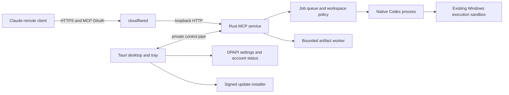

# Rust migration proposal

Status: the Windows service, Tauri desktop, credential migration, signed updater, and normal installer are implemented.
See [implementation and build details](../native/README.md). The sections below preserve the design rationale.
Date: 2026-11-01.

## Recommendation

Replace the TypeScript service with Rust first. Keep the existing Windows manager and installer during this stage.
Then replace the manager with Tauri 2 and a small TypeScript interface, if the service passes the compatibility gates.
Node.js would remain a development dependency for frontend builds. The installed application would not require Node.js for its own server or interface.
The bundled Codex runtime can have separate requirements. Verify its code-mode features before removing Node.js from the complete package.

Rust can reduce runtime dependencies and improve local resource control. It cannot make remote model generation faster.
The existing TypeScript and C# components already use managed memory. Rust does not automatically correct authorization or sandbox defects.

## Current system and measured limits

The installed manager uses C# and .NET Framework 4.8. The MCP service uses TypeScript, Express, and the TypeScript MCP SDK.
Codex and cloudflared run as separate native executables. Sharp supplies native image processing.

These sizes were measured from the local v0.5.0 payload. They are uncompressed executable sizes, not download sizes.

| Component | Size | Migration effect |
| --- | ---: | --- |
| node.exe | 89.57 MiB | Potential removal after service and runtime compatibility checks |
| codex.exe | 354.51 MiB | Retained |
| codex-code-mode-host.exe | 75.44 MiB | Retained until its feature requirements are verified |
| cloudflared.exe | 52.82 MiB | Retained |

The Rust binaries add their own size. WebView2 can add installation work when the system lacks it.
The final size and memory savings require a prototype measurement.
The reported 77.4-second image task includes remote generation. Its duration is not a server performance baseline.

## Target architecture

The pipe separates the public MCP interface from local settings and process control.
It is an interface boundary, not isolation from malicious programs running as the same Windows user.
The manager and service remain trusted programs. Only Codex execution receives the existing sandbox restrictions.

During the first stage, WinForms replaces the Tauri box. Preserve the current private stderr activity protocol for that stage.
Move secret delivery from environment variables to an inherited private handle before adopting the final control pipe.
Do not create an unauthenticated localhost administration API.

## Proposed modules

Use a Cargo workspace with a small number of crates. Pin resolved dependencies in Cargo.lock.

| Module | Responsibility | Candidate implementation |
| --- | --- | --- |
| protocol | Tool schemas, resource formats, activity events | serde and generated JSON schemas |
| service | MCP transports, HTTP limits, authentication middleware | Official rmcp SDK, Tokio, Axum |
| auth | Owner login, PKCE, token families, discovery | Audited crypto libraries and explicit application policy |
| jobs | Queue, cancellation, timeouts, progress, result retention | Tokio tasks and bounded channels |
| workspace | Path validation, file handles, artifact access | Rust filesystem APIs and narrow Windows API wrappers |
| windows | DPAPI, private pipe ACLs, process lifecycle | windows crate with reviewed unsafe code |
| artifacts | MIME checks, image limits, thumbnails | Restricted image decoder worker |
| desktop | Setup screens, tray, account status, local controls | Tauri 2 with bundled HTML, CSS, and TypeScript |

These are module boundaries, not a requirement for eight separate crates.
Prefer shared types over duplicated validation rules.
The SDK supplies protocol support. It does not replace this application's owner authorization policy.
Review server-side OAuth coverage before choosing versions. Do not assume the SDK examples supply production authorization storage.

## Security requirements

### Public requests and login

- Preserve the current four tool names and their input and output schemas.
- Preserve Streamable HTTP and stdio compatibility.
- Bind the tunnel origin listener to loopback only.
- Validate Host, Origin, issuer, resource audience, scope, callback URI, and PKCE S256.
- Keep browser requests bound to their individual login requests.
- Keep authorization codes short-lived and single-use.
- Rotate refresh tokens and revoke their family after reuse.
- Bound request bodies, registrations, pending logins, tokens, and expensive password checks.
- Do not trust forwarded IP headers without an explicit trusted proxy configuration.
- Keep login responses private and non-cacheable.
- Preserve the tested same-origin Referrer-Policy and callback-specific form-action CSP behavior.
- Reject opaque browser origins. Do not accept Origin: null as a login fix.

Preserve in-memory authorization state in the first Rust release. A restart therefore requires a new client login.
Persistent grants are a separate feature. They require transactional refresh rotation, revocation, expiration, and protected storage tests.
All authorized clients still share one owner account and workspace root. This design does not add multiple users.

### Execution and file access

- Use an absolute, pinned Codex executable path and direct process arguments.
- Send prompts through stdin. Do not invoke a command shell for production launches.
- Give each child only the environment variables it needs.
- Keep MCP passwords, Cloudflare account credentials, and updater secrets away from Codex children.
- Retain the current sandbox backend and startup probe. Refuse execution when required isolation checks fail.
- Use bounded queues, output capture, file counts, image dimensions, decoded bytes, and execution times.
- Keep per-workspace ordering and the current concurrency limit during compatibility testing.
- Validate Windows drive syntax, UNC paths, alternate data streams, junctions, and reparse points.
- Resolve and validate opened file handles for artifact reads. String normalization alone cannot stop path replacement races.
- Restrict image formats and run decoding outside the HTTP request task.

Use Windows Job Objects for child lifetime control where compatible with the Codex sandbox.
Create and assign children before resuming execution where the Windows launch path permits it.
Test nested jobs and sandbox descendants before enabling kill-on-close.
Job Objects manage processes and resources. They do not replace a file or network sandbox.
An image worker in another process provides crash containment. Restricted tokens or an equivalent boundary are required for security isolation.

### Local interface and secrets

Use a named pipe restricted to the current user and SYSTEM. Reject remote pipe clients.
Authenticate the expected application session and validate message types, lengths, and protocol versions.
Local commands must be narrow: status, save settings, start, stop, subscribe activity, and explicit account actions.
Do not expose arbitrary process execution or arbitrary file reads to the interface.

Keep current-user DPAPI protection and private folder ACLs.
Import existing Base64 DPAPI blobs with matching entropy and scope; the current C# store uses no optional entropy.
Test import on the same Windows account and device. Do not promise migration to another account or device.
DPAPI does not protect secrets from a compromised program running as the same user.

Tauri must load bundled application pages only. Open Cloudflare, OpenAI, and Claude login pages in the system browser.
Define explicit capabilities for each window and each custom command. Do not enable broad filesystem or shell plugins.
Keep credentials out of frontend state. Show account email and saved-password status through narrow backend responses.
An explicit Copy password action can use the clipboard; it must not send that password to the page as general settings data.

### Updates and installation

Keep a normal per-user setup executable. Preserve the existing tested installer for the first Rust service release.
Evaluate Tauri NSIS after service compatibility passes. Avoid reopening the previous MSI validation problem during the service migration.
Use system WebView2 with a bootstrapper fallback. Show progress if WebView2 needs installation.

Move from GitHub digest-only trust to independently signed update artifacts.
Tauri's updater requires signed artifacts. Protect its signing key separately from ordinary release upload credentials.
Also sign the Windows application and installer with Authenticode when publisher credentials are available.
Publisher signing credentials require a separate operational decision; they are not available through a language migration.

Pin the repository and update channel. Reject unexpected hosts, oversized packages, invalid signatures, and version downgrades.
Stage updates, verify them, stop the service, replace files, and run a startup health check.
Keep a recovery copy of the last accepted version. Record its verified identity before replacement.
Recovery must not permit an arbitrary network downgrade.

The old updater does not understand Tauri update artifacts.
Ship a compatibility release that adds signature verification and understands the transition package before switching the release format.
That first trust upgrade still depends on the existing GitHub trust path. Users can instead install a separately verified signed setup.
Do not publish a Tauri-only package to the old update feed without an upgrade path.

## Interface behavior

Keep the current setup sequence: Workspace, Accounts, Connection, and Use in Claude.
Make Activity visible while jobs run. Keep tray notifications for updates and connection failures.

Show these states separately:

- Codex account: signed out, checking, signed in with email, or unavailable.
- MCP password: not set or saved.
- Tunnel: stopped, starting, connected, or failed.
- Claude: no observed request or last authenticated request time.
- Job: queued, starting, executing, generating, processing output, completed, failed, cancelled, or interrupted.

Do not label the tunnel connection as proof that Claude is connected.
Show saved custom hostnames without requiring another creation step.
Show the configured MCP URL before startup, with a clear offline state until the tunnel becomes ready.
Use validated execution events for activity. Show elapsed time instead of an invented completion percentage.
Exclude prompts, credentials, command output, and image Base64 from routine activity events.
Keep the existing phase marker parser initially. Evaluate structured Codex events in a separate compatibility spike.

## Migration stages and acceptance gates

1. Capture the v0.5.0 behavior and performance baseline.
   Export tool schemas and HTTP behavior fixtures. Measure release builds on the same machine.
2. Build a headless Rust service prototype with fake Codex execution.
   Implement discovery, OAuth, one real browser login, MCP initialization, job polling, cancellation, and activity.
   Keep this prototype on a separate branch and alternate local port.
3. Port execution, workspace checks, and artifacts.
   Reuse existing tests as external compatibility tests. Add Windows race, reparse-point, and resource-limit cases.
4. Connect the existing WinForms manager to the Rust service.
   Preserve settings, DPAPI credentials, Cloudflare configuration, installation identity, workspace locations, and activity behavior.
5. Test a complete packaged installation and update.
   Require actual sandbox denial checks, browser PKCE tests, Claude connection tests, job completion, and artifact retrieval.
   Stop the old service before starting the new listener. Never run two production job owners over the same queue.
6. Evaluate and implement the Tauri interface.
   Test missing WebView2, tray behavior, keyboard navigation, scaling, screen readers, and account status.
7. Release through a tested update transition.
   Remove Node and Sharp only after feature parity and bundled Codex runtime checks pass.

Do not migrate GUI, OAuth behavior, sandbox backend, and installer format in one release.
Keep old settings backups until migration succeeds. Never include plaintext credentials in migration logs.
Existing running jobs cannot transfer between implementations. Drain or explicitly interrupt them before replacement.

## Measurements required before a performance claim

| Measurement | Method | Acceptance |
| --- | --- | --- |
| Service readiness | 20 cold launches; report median and p95 | No regression against baseline |
| Idle memory | Private bytes for service; desktop and WebView2 measured separately | Publish measured difference |
| Local request overhead | Fixed fake child; one and four concurrent jobs | No dropped jobs or activity; compare p95 |
| Artifact processing | Same images, dimension limits, and output quality | Bounded memory and equivalent output |
| Packaging | Compressed bytes, installed bytes, file count | Publish total; identify retained runtimes |
| Installation | Clean install, upgrade, recovery; WebView2 present and absent | No manual copying; no indefinite waits |
| Cancellation | Child tree with nested processes | No orphaned permitted children |
| Security parity | Browser, OAuth, path, sandbox, update abuse tests | All required cases pass |

Record model execution time separately from local service overhead.
Do not claim a percentage speed or memory improvement before collecting these results.

## Open decisions

- Verify which bundled Codex features need Node.js or code-mode-host.
- Confirm rmcp server and OAuth coverage against the current Claude connector behavior.
- Benchmark a bounded Rust image decoder against Sharp before selecting a replacement.
- Verify Job Object behavior with both supported Windows sandbox backends.
- Choose update signing key custody and Windows publisher signing credentials.
- Decide whether persistent OAuth sessions justify a separate storage migration.

## Primary references

- [Official Rust MCP SDK](https://github.com/modelcontextprotocol/rust-sdk): transport and protocol implementation.
- [Rust SDK OAuth documentation](https://github.com/modelcontextprotocol/rust-sdk/blob/main/docs/OAUTH_SUPPORT.md): supported flows and examples.
- [Tauri capabilities](https://tauri.app/security/capabilities/): explicit frontend permissions and custom-command restrictions.
- [Tauri updater](https://v2.tauri.app/plugin/updater/): mandatory update signatures and artifact formats.
- [Tauri Windows installer](https://v2.tauri.app/distribute/windows-installer/): NSIS and WebView2 distribution choices.
- [Microsoft Job Objects](https://learn.microsoft.com/en-us/windows/win32/procthread/job-objects): process groups and limits.
- [Microsoft CryptProtectData](https://learn.microsoft.com/en-us/windows/win32/api/dpapi/nf-dpapi-cryptprotectdata): current-user secret protection.

References checked on 2026-11-01. Pin implementation versions after the prototype compatibility review.
