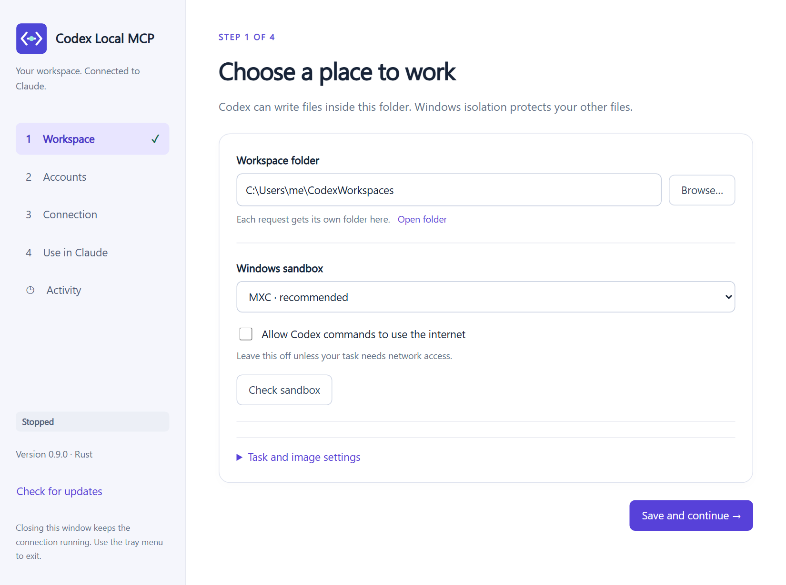
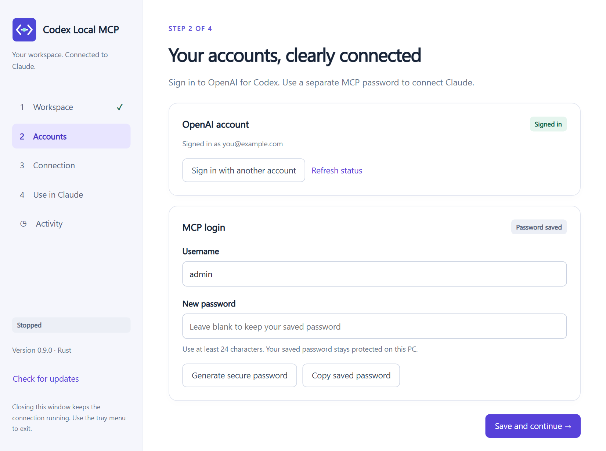
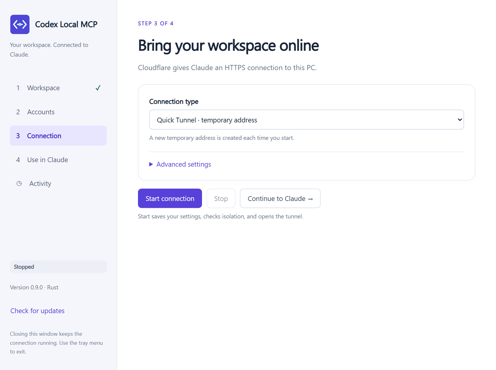
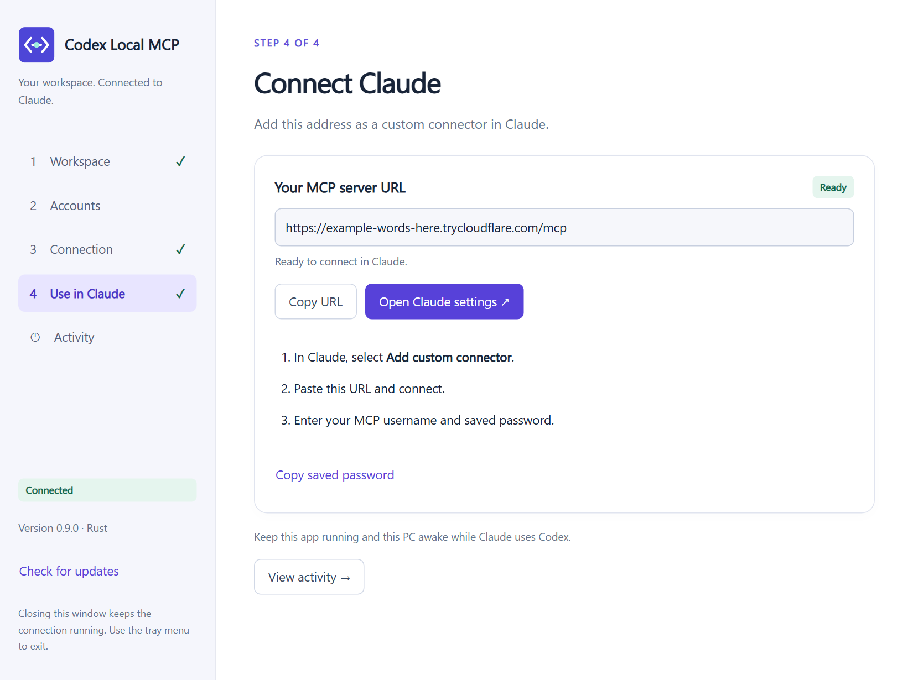
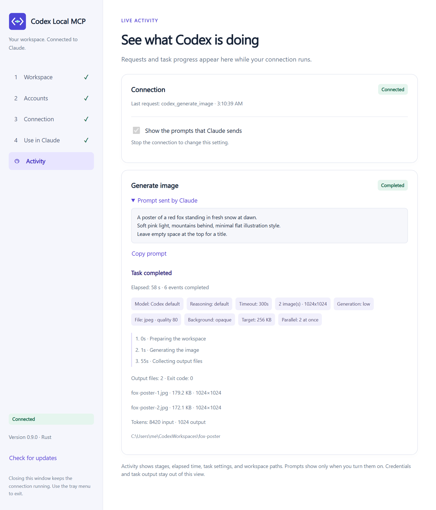

# Windows app guide

This guide sets up **Codex Local MCP** on a Windows PC and connects it to Claude.
When you finish, you can ask Claude to generate images or run coding tasks, and Codex does the
work on your PC. Setup takes about 10 minutes.

- [Before you start](#before-you-start)
- [1. Install the app](#1-install-the-app)
- [2. Choose a workspace](#2-choose-a-workspace)
- [3. Sign in and set the MCP password](#3-sign-in-and-set-the-mcp-password)
- [4. Start the connection](#4-start-the-connection)
- [5. Connect Claude](#5-connect-claude)
- [6. Generate images](#6-generate-images)
- [7. Watch the activity](#7-watch-the-activity)
- [Updates](#updates)
- [Troubleshooting](#troubleshooting)
- [Where your data is](#where-your-data-is)

> [!WARNING]
> Anyone who can use this connector can make Codex run code on your PC, inside its sandbox.
> Keep the MCP password private, and read [SECURITY.md](../SECURITY.md) before you share access.

## Before you start

You need:

- Windows 10 or 11, 64-bit
- An OpenAI account that can use Codex (a ChatGPT plan that includes Codex). You do not need an API key.
- A Claude plan that supports **custom connectors**

You do **not** need Node.js, a Cloudflare account, or a domain for the first setup.

## 1. Install the app

1. Open the [latest release](https://github.com/ossmalaysia/codex-local-mcp/releases/latest).
2. Download `CodexLocalMCP-<version>-windows-x64-setup.exe`.
3. Open the file. Select **Install**, then **Finish**.

The setup file has no Windows publisher certificate, so Windows SmartScreen can show
**Windows protected your PC**. Select **More info**, then **Run anyway**.
To check the download first, compare its hash with the `.sha256` file from the same release:

```powershell
Get-FileHash .\CodexLocalMCP-<version>-windows-x64-setup.exe -Algorithm SHA256
```

The app installs for your Windows account only and adds a Start menu shortcut.
Open **Codex Local MCP** from the Start menu.

## 2. Choose a workspace



1. Select **Browse…** and choose an empty folder, for example `C:\Users\<you>\CodexWorkspaces`.
2. Keep **MXC · recommended** as the Windows sandbox.
3. Leave **Allow Codex commands to use the internet** off, unless your tasks must download things.
   Image generation works without it.
4. Select **Save and continue**.

Codex can write only inside this folder. Each request gets its own subfolder.
Use a dedicated folder, not your Documents or source code folder.

Optional: open **Task and image settings** to change the defaults, such as image size, quality,
and file format. Claude can still change them for each request.

## 3. Sign in and set the MCP password



There are two separate logins:

| Login | What it is for |
|---|---|
| **OpenAI account** | Lets Codex work. It uses your ChatGPT sign-in, not an API key. |
| **MCP login** | Protects your PC. Claude must enter this username and password to connect. |

1. Select **Sign in to OpenAI** and complete the sign-in in your browser.
2. Keep the username `admin`, or type your own.
3. Select **Generate secure password**. The app saves it, encrypted, on this PC.
4. Select **Copy saved password** and store it in your password manager.
5. Select **Save and continue**.

## 4. Start the connection



1. Keep **Quick Tunnel · temporary address** for the first setup.
2. Select **Start connection**.

The app first checks that the sandbox works. It then opens a secure HTTPS address through
Cloudflare. The sidebar status changes to **Connected**.

| Connection type | Address | When to use it |
|---|---|---|
| **Quick Tunnel** | A new random `trycloudflare.com` address each time you start | Trying the app. No account needed. |
| **Custom domain** | A fixed address on your own domain, for example `https://codex.example.com` | Daily use. You need a free Cloudflare account and a domain in it. |

To use your own domain, select **Custom domain**, then **Sign in to Cloudflare**. Choose the
domain and an address name, then select **Create or use this address**. The app creates the
tunnel and the DNS record for you.

## 5. Connect Claude



1. Select **Copy URL**.
2. Select **Open Claude settings**, or open **Settings → Connectors** in Claude.
3. Select **Add custom connector**. Type a name, such as `Codex`, and paste the URL.
4. Select **Connect**. A login page from your PC opens.
5. Enter the MCP username and password from step 3. Select **Sign in and connect**.

Claude stays signed in for 30 days, including across app restarts and updates.
It must sign in again if you change the MCP username or password, or if the address changes.
A Quick Tunnel address changes every time the connection starts, so you must update the
connector URL in Claude after each start. A custom domain keeps its address.

Keep the app running and the PC awake while you use the connector. Closing the window keeps the
app in the system tray. To stop it, select **Exit** from the tray menu.

## 6. Generate images

In a Claude chat with the connector turned on, describe what you want. For example:

> Use Codex to generate an image of a red fox standing in fresh snow at dawn, soft pink light,
> minimal flat illustration style.

> Use Codex to make 3 versions of a logo for a coffee shop called "Bean There", 1024x1024, PNG,
> transparent background.

> Use Codex to generate a 1536x1024 banner of a mountain lake at sunset, high quality.

You can ask for any of these settings in plain words. Claude passes them to the tool.

| Setting | Values | Default | Notes |
|---|---|---|---|
| Number of images | 1–10 | 1 | Images generate in parallel, up to 4 at a time. |
| Size | `WIDTHxHEIGHT`, for example `1024x1024` or `1536x1024`, or `auto` | `1024x1024` | The saved file keeps the aspect ratio and is never enlarged. The result shows the real size. |
| Quality | `low`, `medium`, `high`, `auto` | `low` | `low` is a fast draft. Use `high` for final images. |
| File format | `jpeg`, `png`, `webp` | `jpeg` | Use PNG or WebP for a transparent background. |
| Background | `opaque`, `transparent`, `auto` | `opaque` | JPEG cannot be transparent. |
| Target file size | 16–10240 KB | 256 KB | A preference, not a guarantee. Applies to JPEG quality. |

What happens next:

- Each image is saved in a new folder inside your workspace. The result shows the full path.
- The image also opens in the default image viewer on your PC.
- Claude receives a smaller preview of each image, so it can describe or check the result.
- An image often takes longer than one minute. Claude then gets a `job_id` and asks for the result
  again. This is normal; you do not need to do anything.

Tips for better images:

- Describe the subject, the style, the light, and the layout, for example "leave space at the top for a title".
- Ask for `low` quality first. When you like the idea, ask again with `high` quality.
- Ask for several images at once to compare versions. They generate at the same time, but each
  image uses your OpenAI image allowance.

Codex can also do general tasks in the same workspace, for example:

> Use Codex to write a Python script that resizes every image in the fox-poster folder to 512 pixels wide.

## 7. Watch the activity



Open **Activity** to see each request while it runs: the stages, the elapsed time, the task
settings, the output files with their real size, and the token usage.

To review and improve your prompts, stop the connection and turn on
**Show the prompts that Claude sends**, then start it again. Each task then shows the prompt and
a **Copy prompt** button. This setting is off by default, and prompts stay in memory only.

Settings are locked while the connection runs. Select **Stop** to change them.

## Updates

The app checks for a new version at startup and every 12 hours. You can also select
**Check for updates** in the sidebar or the tray menu.

1. Select **Install update**. The app downloads the new version and checks its signature.
2. Select **Install** in the setup window.

If the connection was running, the app starts it again after the update, and Claude stays signed in.
Your settings, passwords, and workspaces are kept.

## Troubleshooting

| Problem | What to do |
|---|---|
| **Start connection** fails at the sandbox check | Install all Windows updates and try again. If MXC is not supported on your PC, select **Windows restricted token** as the sandbox on the Workspace page; its setup can ask for administrator approval. |
| Claude says the connector cannot connect | Check that the sidebar shows **Connected**. With a Quick Tunnel, copy the new URL and update the connector in Claude. |
| Claude asks you to sign in again | This is expected after you change the MCP username or password, or after a Quick Tunnel restart. Enter the MCP login again. |
| The OpenAI account shows **Not signed in** | Select **Sign in to OpenAI** on the Accounts page. |
| An image task fails with a rate limit | You reached your OpenAI image limit. Wait, or ask for fewer images at once. |
| The image is not the exact size you asked for | The image tool chooses the final size. The result and Activity show the real dimensions. |
| The app window is gone | It is in the system tray. Select the tray icon to open it. |

## Where your data is

| Item | Location |
|---|---|
| Your images and task files | The workspace folder you chose |
| Settings, encrypted passwords, OpenAI and Claude sign-ins | `%LOCALAPPDATA%\CodexLocalMCPData` |
| The app | Shown under **Settings → Apps → Installed apps** as **Codex Local MCP** |

Passwords and tunnel tokens are encrypted for your Windows account with DPAPI.
The Codex sandbox cannot read the data folder. Uninstalling the app keeps your settings and workspaces.
